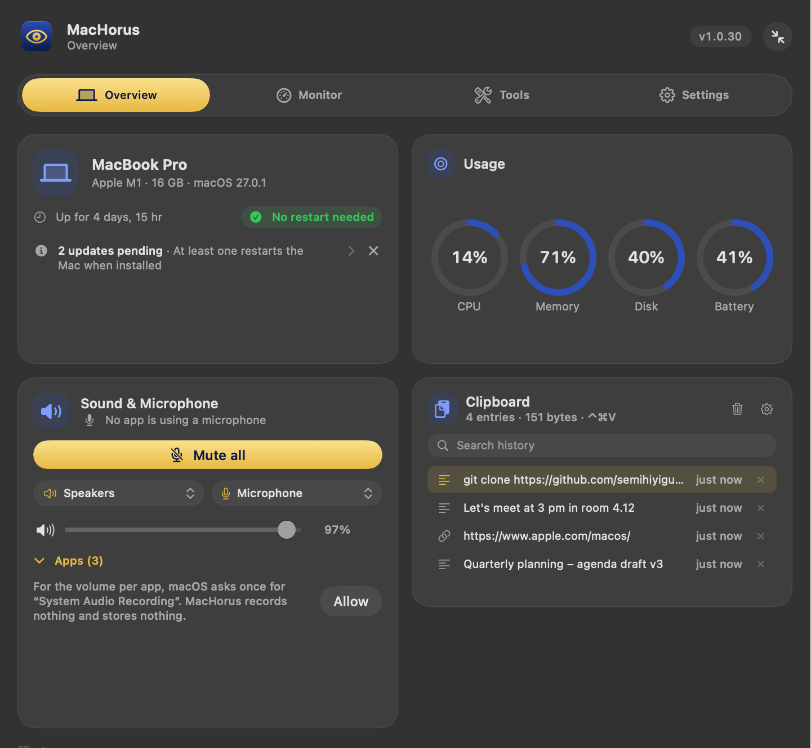
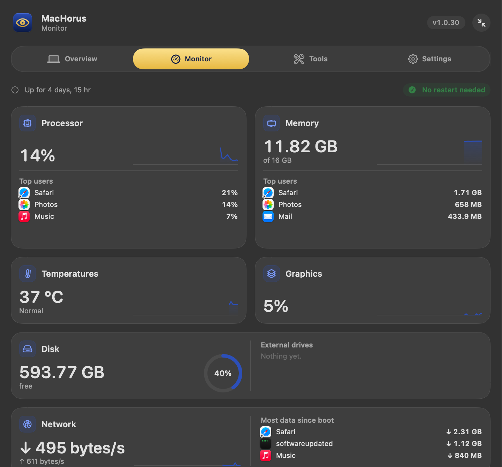
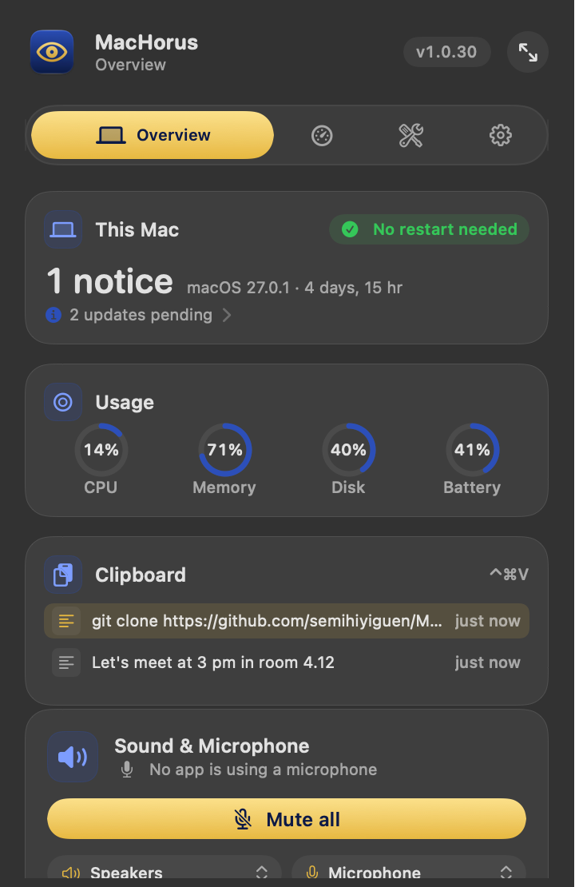
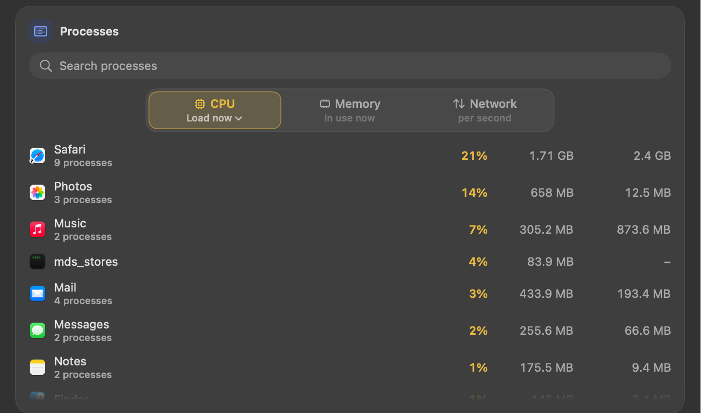
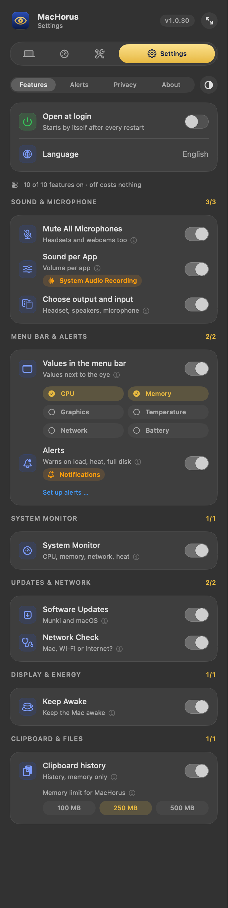
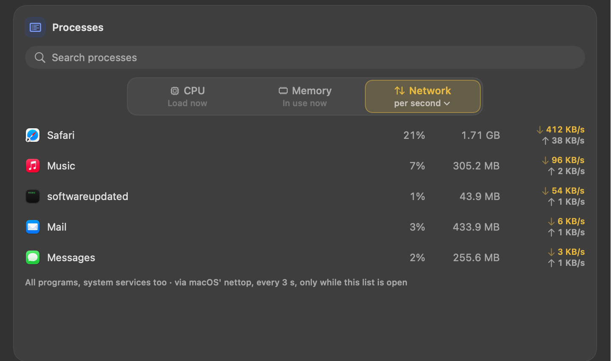
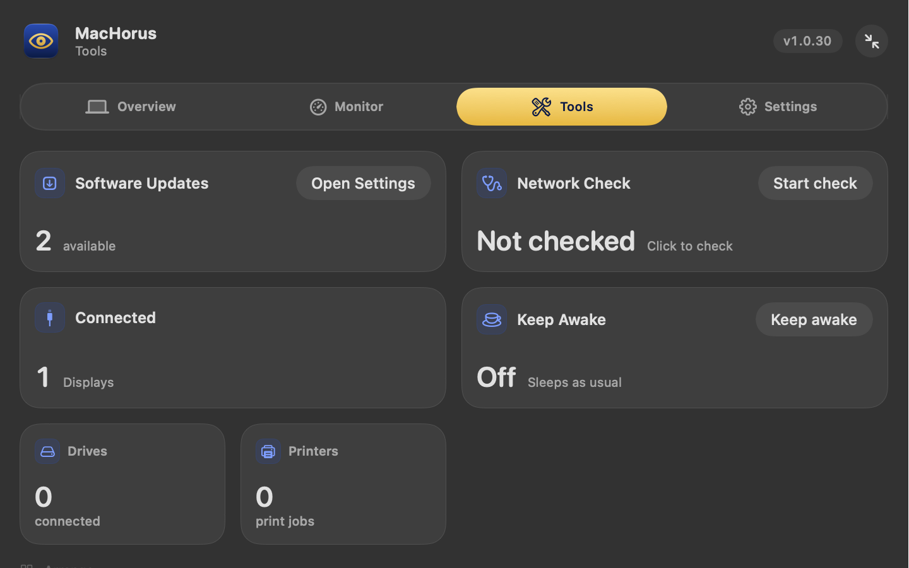
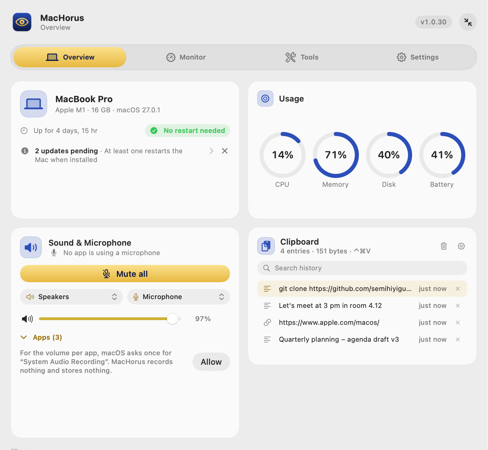

<div align="center">


# MacHorus

**A fast, private system monitor and toolbox for the macOS menu bar.**

CPU, memory, GPU, temperatures, network per app, VPN, disk, battery and processes, plus sound per app, microphone mute, clipboard history, keep awake and more, in one light app.<br>
No account. No telemetry. No admin rights. Nothing leaves your Mac.

[](LICENSE)


[Quick start](#quick-start) · [Screenshots](#screenshots) · [Features](#features) · [Privacy](#privacy-and-security) · [Docs](#documentation)



</div>

## Why MacHorus

- **Everything in one place.** A system monitor and the small tools you reach for every day, behind one eye in the menu bar.
- **Light by design.** It measures only what is on screen. With the panel closed it costs about as much as an app that was never opened. Every switched-off feature costs nothing.
- **Private by design.** No account, no analytics, no update check. The only network access is the network check, and only when you click it.
- **Honest numbers.** Every value is verified against a macOS tool such as Activity Monitor, `top`, `nettop` or `pmset` ([how](docs/MEASUREMENTS.md)).
- **Yours to arrange.** Every page is a board of widgets in five sizes, arranged like widgets on a phone, in a compact and an expanded panel.

## Quick start

```bash
git clone https://github.com/semihiyiguen/MacHorus.git && cd MacHorus
make app && cp -R build/MacHorus.app /Applications/ && open /Applications/MacHorus.app
```

Needs macOS 14.2+ and the Command Line Tools (`xcode-select --install`). Details in [Install](#install).

## Screenshots

<table>
  <tr>
    <td width="66%"></td>
    <td width="34%"></td>
  </tr>
  <tr>
    <td></td>
    <td rowspan="2"></td>
  </tr>
  <tr>
    <td></td>
  </tr>
  <tr>
    <td colspan="2"></td>
  </tr>
</table>

<sub>Screenshots use the built-in demo mode (`-debug.demo YES`): app names, device names and network per app are sample data, everything else is measured live.</sub>

<details>
<summary>Light mode</summary>
<br>

</details>

## Features

| Area | What you get |
|---|---|
| **Overview** | This Mac at a glance (model, macOS, uptime, restart advice, pending updates), load as colored rings, clipboard, sound |
| **Monitor** | CPU with P/E cores, memory the way Activity Monitor counts it, GPU, temperatures and fans, disk with the largest folders on request, network per app, VPN, battery, processes with search, sort switch, filters and safe quit |
| **Sound** | Overall volume, volume per app, mute all microphones, switch input and output devices |
| **Tools** | Keep awake, network check (Mac, Wi-Fi or internet?), pending macOS and Munki updates, attached displays and devices, drives with safe eject, stuck print jobs, listening ports |
| **Clipboard** | History in memory only, with images, links and text recognized on the Mac; global shortcut |
| **Menu bar** | Live values next to the eye, alerts for lasting load, heat, memory pressure, a full disk or an empty battery |
| **Settings** | Every feature on or off, a privacy page that shows which feature uses which permission, English and German |

## Install

There is no notarized download yet; building it takes a few minutes:

```bash
xcode-select --install          # Command Line Tools, if missing (no Xcode needed)
git clone https://github.com/semihiyiguen/MacHorus.git
cd MacHorus
make app                        # universal build: build/MacHorus.app
cp -R build/MacHorus.app /Applications/
open /Applications/MacHorus.app
```

Requirements: macOS 14.2 Sonoma or later, Apple Silicon or Intel. Building needs the Command Line Tools with the macOS 26 SDK (`MacOSX26.sdk`), which the Makefile pins.

Optional: run `scripts/setup-signing.sh` once before `make app`. It creates a local signing identity, so macOS keeps the permissions you granted when you rebuild.

## Privacy and security

| | |
|---|---|
| Network | Only the network check, on click, to Apple's captive portal probe. No other request exists in the code. |
| Data | Settings in `UserDefaults`. The clipboard history lives in memory and is gone when MacHorus quits. |
| Permissions | Only what a feature needs, asked by macOS the first time it is needed. Never: admin rights, Full Disk Access, Accessibility, Screen Recording. |
| Private APIs | Four read-only interfaces (network counters, temperature sensors, SMC, process grouping), each with a fallback and a switch for administrators. |

Details: [docs/PRIVACY.md](docs/PRIVACY.md) · Report a vulnerability: [SECURITY.md](SECURITY.md)

## For administrators

Force features on or off, or disable private interfaces, with a configuration profile. MacHorus also shows pending Munki updates if Munki is installed, and `make release` / `make pkginfo` build an installer package and a Munki pkginfo. See [docs/ADMINISTRATION.md](docs/ADMINISTRATION.md).

## Documentation

| Document | Content |
|---|---|
| [ARCHITECTURE.md](docs/ARCHITECTURE.md) | Modules, principles, widget board |
| [MEASUREMENTS.md](docs/MEASUREMENTS.md) | How every value is measured and verified |
| [PRIVACY.md](docs/PRIVACY.md) | Permissions, private APIs, network |
| [ADMINISTRATION.md](docs/ADMINISTRATION.md) | Policy keys, deployment |
| [TROUBLESHOOTING.md](docs/TROUBLESHOOTING.md) | Missing values, diagnosis for bug reports |

## Roadmap

- Signed and notarized release downloads
- More languages (translations are welcome: one `.strings` file per language)
- Measurements verified on more Macs (Intel, M2–M5): reports with `--print-diagnosis` help

## Contributing

Bug reports, measurements from other Macs and pull requests are welcome. Please read [CONTRIBUTING.md](CONTRIBUTING.md) first. For a bug report, add the output of:

```bash
/Applications/MacHorus.app/Contents/MacOS/MacHorus --print-diagnosis
```

It contains no serial number, computer name, addresses or app names.

## Acknowledgements

Some approaches (SMC parameter layout, per-app volume with Core Audio process taps, grouping helper processes by their responsible app) follow [Vorssaint utils](https://github.com/vorssaint/vorssaint-utils) (GPL-3.0). The source comments say where.

## Support the project

If MacHorus is useful to you, **star the repository** ⭐ – it helps others find it. Bug reports and measurements from other Macs are just as welcome.

## License

MacHorus is free software under the [GNU General Public License v3.0 or later](LICENSE). You may use, study, share and change it. If you distribute it or a changed version, it must stay under the same license, with its source and copyright notices.
